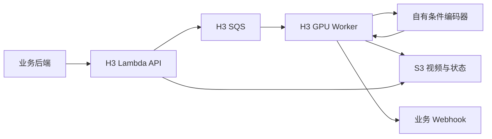

# 技术设计

日期：2026-10-29。本文的“首版”“应”“计划”均为设计约定，不代表功能已经实现。

实现补充：首版已采用每阶段独立子进程，未保留模型 CPU 常驻权重；两阶段完全退出交接 GPU，接受每单冷加载成本。远程自有 conditioner 仍为后续选项。具体已完成范围见 VALIDATION.md。

## 1. 目标与范围

基于 MiniMax-H3 和 10Eros beta5 Turbo 提供图生视频服务，沿用现有业务的异步任务接入方式。首版支持首帧、可选尾帧、提示词、种子、时长和原生音视频输出；尾帧约束强度需实测，不承诺像素级锁定。

首版不引入 ComfyUI 服务依赖，不复用公共 Space 的计算资源，不自动切换模型版本，不改变现有 Wan 队列和服务。文生视频、1080p、量化、稀疏注意力、额外 LoRA、AoTI、批量并发作为后续独立工作。

## 2. 已有证据与未知项

| 项目 | 已读到的事实 | 仍需验证 |
| --- | --- | --- |
| 权重 | Space 使用 `TenStrip/10Eros-Max` 的 `10Eros_Max_h3_TURBO-hybrid_beta5.safetensors`，文件为 40,222,982,192 字节 | 与指定 Civitai 文件是否哈希一致 |
| 转换 | `h3_eros.py` 做键映射、QKV 拆分、SwiGLU 排列交换、AdaLN 重建 | 完整推理和成片效果是否正确 |
| 参数覆盖 | Space 文档报告替换 634/638 个张量，保留四个 time-embedder 张量 | 在固定版本上重新统计名称和覆盖率 |
| Turbo | beta5 TURBO 已融合加速权重；Space 默认 6 步 | 不同长度、画布的动作、音频质量 |
| 端到端 | Space README 明确称 Eros 版本尚未完成 ZeroGPU 端到端运行 | 我们的 GPU 上完整验证 |
| 显存 | 基础生成侧约 72.16 GiB 权重，条件编码器约 62.15 GiB；基础模型特定测试 reserved 峰值约 85.37 GiB | Eros、目标时长及分阶段调度的真实峰值 |

以上显存和速度记录来自上游，不是本项目测量。磁盘 checkpoint 大小不能当作展开后显存需求。作者说明中的余弦结果不是 `apply_eros()` 运行时执行的校验。AdaLN 重建也不等同于已经证明完整采样过程等价。

## 3. 模型与依赖

### 3.1 固定组成

- 基础配置与组件：`MiniMaxAI/MiniMax-H3`。
- Eros：上述 beta5 Turbo 文件；已查到的 HF LFS SHA-256 为 `098f138f3e899d03821dd8296c8db3db6fa16371e50fcdd38661d347fd9a1dfa`，下载后必须本地校验。
- 条件编码：H3 配套 Qwen3-VL text encoder、tokenizer、processor。
- 解码：H3 video VAE、audio VAE；保留上游要求的 FP32 模块，不能为了节省显存统一强转 BF16。
- 调度器：固定基础仓库配置及 pipeline 版本，不把 ComfyUI 的采样器名称直接映射成 Diffusers 参数。

首版先加载基础 Transformer，再逐张量覆盖，避免在尚未验证时增加直接构造转换权重的变量。后续可离线转换并保存为 Diffusers 布局，减少每次启动的重复读取；这是优化项。

### 3.2 固定环境

Space 当前 requirements 的候选组合：Python 兼容版本待核对，torch 2.11.0、torchvision 0.26.0、transformers 5.8.0、accelerate 1.14.0、huggingface-hub 1.24.0，PyTorch cu130 源。

Diffusers 固定 commit：`665f578278365ea4a3318cb8c9b66ce6c01204b9`，来自 PR #14371。这是复现实验起点，不是已通过本地安装的依赖锁。先核对 GPU 驱动兼容性，再建立独立 venv；不能升级 Wan 的现有环境。固定版本通过验收后不随 PR 自动更新。

移植时记录 Space 完整 commit、基础模型 revision、Eros revision、文件哈希、第三方文件来源和许可证。上游模型卡提及多个源模型许可，正式部署前核对适用条款。只移植实际需要的代码，不整体启动 Space 的 `app.py`，不默认携带其 ZeroGPU、Gradio、远程编码和后台线程。

### 3.3 权重转换验收

转换模块必须输出：来源文件哈希、加载张量数、目标覆盖清单、跳过清单、保留基础参数清单。未知键、重复目标、形状不符、非有限值和非预期遗漏均启动失败；只有列明的 reference 辅助张量及基础保留参数允许例外。

单测验证 QKV 拆分、gate/value 交换、AdaLN 的 `W = W_ref @ basis`、`b = b_ref - W @ mean`。真实权重额外抽查参考运算与转换后运算的误差。数值容差必须根据 dtype 明确制定并保留结果，不能以形状匹配替代数值验证。

额外 Turbo LoRA 默认关闭，首版不加载 `h3_lora.py` 中未使用的权重。关闭 LoRA 不代表关闭 Eros。

## 4. 部署拓扑与显存调度



### 默认方案：单机单卡、分阶段使用 GPU

以现有 96GB 级 GPU 为候选目标。条件编码和生成不能按原精度同时常驻。

1. 单任务占住执行位；下载首尾图，统一 EXIF、RGB、裁剪及画布处理。
2. 生成模型保持在 CPU；条件编码器上 GPU，编码文本和图像，结果落到 CPU。
3. 编码器退出 GPU，检查真实空闲显存；生成组件再上 GPU。
4. 去噪、视频解码、音频解码、封装 MP4。
5. 下一单编码前把生成组件移回 CPU，保持明确的 GPU 所有权。

优先设计为一个 worker 控制独立的 conditioner 子进程：显存释放不可靠时可终止子进程回收 CUDA context。不得仅用 `empty_cache()` 代替卸载活跃权重。CPU 同时保留两部分权重会占用超过 130 GiB 的主机内存，加载、转换和视频缓冲还需要额外空间；256 GiB RAM 只是初始容量建议，部署 preflight 必须实测，不能视为足够的保证。

### 可选方案：独立条件编码 GPU

通过配置使用自有 conditioner 服务，生成侧可常驻 GPU，减少逐单搬运。需要额外 GPU，不作为首版默认资源假设。远端传输只允许受控内网端点和身份认证，不允许请求方指定任意编码服务 URL。

编码接口返回 `prompt_embeds`、`text_token_tags` 和实际画布/帧数；参考上游 safetensors 格式，不使用 pickle 交换网络数据。校验维度、dtype、大小、版本和有限值。编码与生成必须看到完全相同的预处理图片。默认关闭提示词改写。

## 5. 对外协议

独立部署 H3 Lambda 和队列，保留 `/v1/generate`、`/v1/tasks/{task_id}` 路径；不能把 H3 任务放进现有 Wan 队列。GPU HTTP 只暴露 `/health`、`/ready`。

| 字段 | 首版约定 |
| --- | --- |
| `image` | 必填 HTTPS 首帧；生产 API 不接受服务器本地路径 |
| `lastImage` | 可选 HTTPS 尾帧 |
| `prompt` | 必填非空；不静默使用业务未知的默认词 |
| `negativePrompt` | 为兼容保留；非空时返回 422，明确不支持 |
| `duration` | 默认 5 秒，初始限制 2–14 秒；帧网格向上取整 |
| `resolution` | 初始仅 `540p`、`720p`，默认 `540p`；480p、1080p 返回 422 |
| `seed` | 可选；未提供时由 worker 确定，并在生成前持久化，重投复用 |
| `steps` | 默认 6；首版允许 4–8 整数，范围内的质量仍需验证 |
| `audio` | 默认 false，与 Wan 一致；true 保留原生音轨，false 输出无音轨 MP4；不能声称 false 一定减少去噪计算 |
| `quality` | 首版不支持自定义；非空返回 422，导出预设固定并记录 |
| `webhookUrl` | 可选；限制 HTTPS、允许主机范围，并拒绝链路本地地址 |

帧数使用 `ceil(duration * 24)` 后向上对齐至 `17n+5`。例如 5 秒变为 124 帧，实际约 5.167 秒。必须返回 `num_frames`、`fps`、`actual_duration`，请求的 `duration` 保持原值。H3 的时长/画布范围不能直接复制 Wan 的 `(0,15]` 校验。

初始画布只开放 16:9 和 9:16：540p 为 960×544 / 544×960；720p 为 1344×768 / 768×1344。依据首帧选择方向，按该画布裁剪首尾图，不让尾帧重新决定画布。`resolution` 是档位名称，实际尺寸必须随结果返回。其它比例待独立验收后开放。

提交成功返回 202 和 `{id, task_id, status: queued}`。429 表示队列近似积压限制，不能解释为严格容量锁。503 表示依赖不可用。字段不支持时在入队前拒绝，不能静默忽略。

## 6. 状态、幂等与回调

状态主线：`queued → pending → generating → succeeded / failed`。额外 `stage` 表示 download、conditioning、denoise、decode、upload。查询可派生 `stalled`，但它不是持久化失败终态，也不自动触发第二份生成。

- S3 前缀独立为 `video/h3/`；视频 `{prefix}{task_id}.mp4`，状态 `{prefix}status/{task_id}.json`。
- 状态保留 request、resolved 参数、模型版本、worker、阶段计时和时间戳；串行写入，避免 heartbeat 覆盖终态。不要把已有 request 在阶段切换时丢掉。
- 入队前写 queued；状态写入失败不入队。SQS SendMessage 超时可能已被接受，首版返回 503/enqueue_unconfirmed 和 task_id，保留 queued，不贸然标记失败压掉实际任务。入口重试可能产生不同 task_id，首版不宣称跨提交幂等。
- 终态检查必须早于最大重投次数检查，防止成功任务被误改成 poisoned。
- S3 读取失败不能当作对象不存在；发生此情况先退避，不盲目重跑昂贵推理。
- SQS 至少一次投递，visibility 续租并不是全局排他锁。首版只支持一个 worker 消费该队列；扩容前增加带 fencing 的外部任务租约。首版仍需承认崩溃窗口可能造成重复计算。
- 不复制 Wan 的“状态写失败后照常删消息”语义。终态持久化失败时保留消息，优先恢复状态；已上传视频用对象 metadata 中的 task_id、模型版本及结果元信息辅助恢复，不能只看同名对象存在就宣布成功。
- 确定性输入/推理失败记终态，不无限重跑；下载、S3、队列、回调的短暂故障采用有上限的退避。完全非法的消息 envelope 不删除，交队列 redrive policy 转入 DLQ；部署必须配置 DLQ。
- 回调在终态成功落盘后发送；失败记录 callback 状态。重投看到终态时仅补回调，不重复推理。成功回调但确认写入失败可能再次通知，业务端必须按 task_id 幂等消费；不承诺 exactly-once。
- 回调成功或重试耗尽并记录后删除 SQS 消息；耗尽后以查询为兜底，并提供运维补发入口。

回调保留 `id/task_id/status/video_url/error/seed/duration/resolution`，增加实际尺寸、实际时长和音轨存在标志。为接入兼容，签名头继续用 `X-Wan-Signature`，对原始 JSON 字节做 HMAC-SHA256；H3 使用独立 secret，由运行环境注入，不写入文档、代码或日志。

候选错误码：invalid_input、download_failed、conditioning_failed、generate_failed、decode_failed、invalid_output、upload_failed、poisoned。基础设施故障与生成失败分开记录，完整异常仅进内部日志。

## 7. 目录与职责（计划）

```text
minimax_h3/
  README.md  docs/  requirements*.txt
  deploy.sh  start.sh  worker-env.sh  .env.example
  h3_service/
    config.py  log.py
    api/              # worker 探活
    contracts/        # 轻量请求、响应、消息结构；不导入 torch
    tasks/            # SQS、执行位、续租、状态恢复
    infer/            # 模型加载、转换、编码调度、生成、导出
    media/            # 下载、预处理、S3、状态、回调
    net/              # URL 校验
  lambda_api/         # 轻依赖接单及查询；独立打包
  tests/              # CPU 单测与集成测试
  benchmark.py        # 无队列、无上传、无回调的 GPU 验证
  third_party/        # 来源、版本、许可与移植说明
```

参考 Wan 的 contracts、SQS 和媒体处理结构，但不从 `../server` 动态导入运行代码。首版独立实现适配层，避免两套模型配置耦合。

日志记录每阶段耗时、模型加载时间、搬运时间、CPU/GPU 内存、音轨信息；提示词原文、带签名的图片 URL 不写普通日志。状态对象含业务请求，需要私有读写权限；成片可走 CloudFront，状态查询走 Lambda。

## 8. 来源

- [目标 Civitai 页面](https://civitai.red/models/2851079/h3-eros-max?modelVersionId=3294059)：正文受登录限制，未核实下载文件。
- [10Eros 模型卡](https://huggingface.co/TenStrip/10Eros-Max)、[文件列表](https://huggingface.co/TenStrip/10Eros-Max/tree/main)。
- [Space README](https://huggingface.co/spaces/Daankular/H3EROS/blob/main/README.md)、[权重转换](https://huggingface.co/spaces/Daankular/H3EROS/blob/main/h3_eros.py)、[应用](https://huggingface.co/spaces/Daankular/H3EROS/blob/main/app.py)、[依赖](https://huggingface.co/spaces/Daankular/H3EROS/blob/main/requirements.txt)。
- 本地参考：`../../server/wan22/tasks/`、`../../server/wan22/media/`、`../../server/lambda_api/`；旧 `JAVA.md` 不作为当前协议权威来源。
